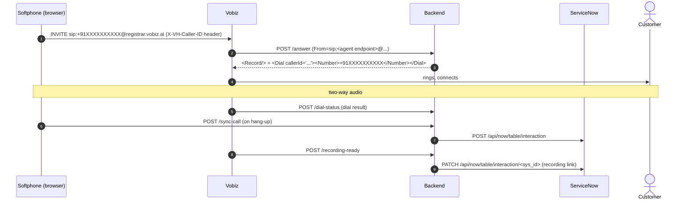
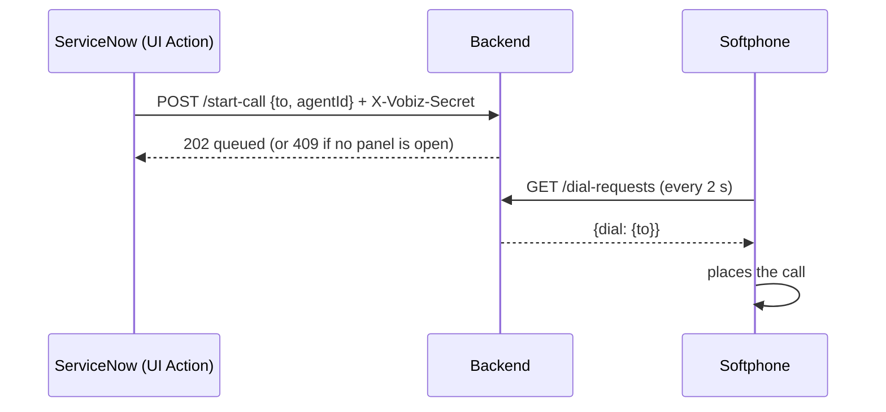
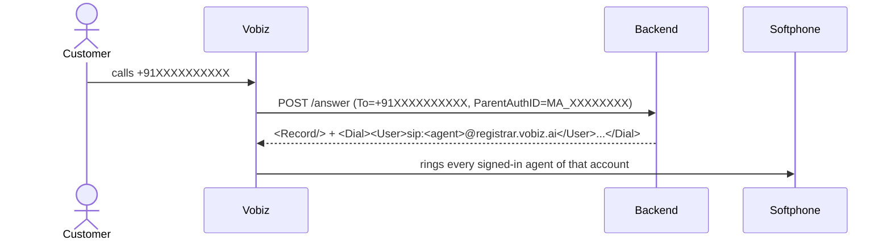

# Architecture

How the pieces of Vobiz Calling for ServiceNow fit together. For setup, see the
[README](../README.md).

## Components

| Piece | Where it runs | What it does |
| --- | --- | --- |
| Softphone (`agent-phone/`) | The agent's browser, in the OpenFrame panel or a tab | A WebRTC SIP phone (JsSIP). Signs in, registers with `wss://registrar.vobiz.ai:5063`, places and answers calls, lists recordings |
| Backend (`backend/server.js`) | Your server, on a public HTTPS address | Serves the softphone, signs agents in and sets up their Vobiz account, answers Vobiz webhooks, proxies recordings, writes to ServiceNow |
| **Call via Vobiz** UI Action (`servicenow-app/ui-actions/`) | The ServiceNow server | Sends a record's phone number to the backend with the shared secret |
| System properties (`servicenow-app/sys_properties/`) | ServiceNow | `vobiz.calling.tunnel_url` and `vobiz.calling.shared_secret` |
| OpenFrame configuration (`servicenow-app/openframe/`) | ServiceNow | Mounts the softphone in the Next Experience header |

## Outbound call

The browser places every outbound call. Vobiz then asks the backend's answer
URL how to connect it, and the backend dials the customer.



The SIP username in `From` tells the backend which agent and account the call
belongs to. The caller ID comes from the `X-VH-Caller-ID` header, or the number
the agent picked, and must be one of the account's numbers. A SIP user nobody is
signed in as gets a spoken message and a hang-up.

## Click-to-call

The UI Action runs on the ServiceNow server and cannot reach the agent's
browser, so the backend holds the number until the agent's softphone collects
it. The browser still places the call, exactly as above.



The backend picks the open panel whose `agentId` equals the ServiceNow user name
in the request. If no panel matches and exactly one panel is open, that panel is
used. A queued number expires after 30 seconds.

## Inbound call



The backend finds the account from `ParentAuthID`, or from the dialled number.
If no agent of that account is signed in, the caller hears a short apology and
the call ends. Numbers reach the backend only after an agent presses **Enable
inbound calls**.

## Sign-in and provisioning

At a Vobiz-account sign-in the backend:

1. Checks the Auth ID and Auth Token by listing the account's numbers.
2. Finds or creates the application **ServiceNow Calling (Vobiz)** with answer
   URL `<PUBLIC_BASE_URL>/answer`. It never changes another application.
3. Finds or creates the agent's SIP endpoint, sets a new random password, and
   attaches it to the application.
4. Saves the endpoint id and username in `DATA_DIR/endpoints.json`.

The Auth Token and the SIP password stay in memory. SIP-direct sign-in skips all
of this; the backend only records the endpoint's caller ID.

## State

| State | Where | Survives a restart |
| --- | --- | --- |
| Sessions, Auth Tokens, SIP passwords | Memory | No: agents sign in again |
| Recent calls (last 200) and queued click-to-call numbers | Memory | No |
| Endpoint ids per account and agent | `DATA_DIR/endpoints.json` | Yes |
| Interaction records | ServiceNow | Yes |
| Recordings | Vobiz | Yes |

Because state is in memory, run one backend instance.

## Recording playback

Recording links carry the account, an expiry and an HMAC signature over
account, recording (or call) and expiry, made with `SIGNING_SECRET`. The backend
checks the signature, looks the recording up in that account through the Vobiz
API, and streams the audio. It fetches only from Vobiz hosts, checks every
redirect, and never takes a media address from the request.

## Deployment

```
ServiceNow ──HTTPS──▶ reverse proxy or load balancer ──▶ backend (one instance)
                                                       │
Vobiz ─────HTTPS webhooks──────────────────────────────┘
```

For a trial, `npm run tunnel` replaces the reverse proxy with a Cloudflare quick
tunnel.
